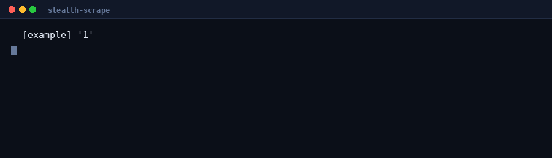

# stealth-scrape

Config-driven Selenium scraping that keeps working when a site doesn't want to be scraped.

Most scrapers break for one of three reasons: the site returns a block page with a `200 OK`, the content is rendered client-side and never appears in the HTML, or a selector changed and the scraper silently emits empty rows. This handles all three — and **adding a new site is a YAML file, not code**.



```bash
python -m stealth_scrape --site olx --query "rtx 3090" --out results.csv
```

```
  [olx] 'rtx 3090'
    → https://www.olx.ro/oferte/q-rtx-3090/
    ✓ 41 rows

41 rows → results.csv
```

```csv
title,price,location_date,url,image,query,site
Placa Video RTX 3090 MSI Ventus 3x 24gb,4 200 lei,"Bucuresti, Sectorul 5 - 08 august 2026",https://www.olx.ro/d/oferta/...
RTX 3090 Ti GameRock 24GB,5 500 lei Prețul e negociabil,Oradea - 30 iulie 2026,https://www.olx.ro/d/oferta/...
```

---

## Why it works

### 1. A real browser, with the automation tells removed

Plain HTTP clients get consent walls and 403s. Headless Chrome has its own detectable signature. This runs headed Chrome with the fingerprints that WAF vendors actually check suppressed — `navigator.webdriver`, the automation switches, plugin and language stubs — injected via CDP *before* page scripts run, not after.

```python
driver.execute_cdp_cmd("Page.addScriptToEvaluateOnNewDocument", {"source": STEALTH_JS})
```

Timing matters: `execute_script` after load is too late, the page has already fingerprinted you.

### 2. Block pages are detected, not parsed

A `200 OK` means nothing. WAF challenges, captcha interstitials, consent walls and un-hydrated SPA shells all return 200 with a body containing no data. `blocking.inspect()` classifies the response before extraction:

| Kind | Trigger |
|---|---|
| `WAF` | AWS WAF, Cloudflare, DataDome, PerimeterX, Incapsula markers |
| `CAPTCHA` | reCAPTCHA / hCaptcha assets |
| `RATE_LIMIT` | "unusual traffic", 429-style interstitials |
| `CONSENT` | consent wall with no content behind it |
| `EMPTY` | body under 4 KB — a shell, not a page |

Without this you don't get an error, you get **"0 results"** — the failure mode that quietly corrupts a dataset.

### 3. When the site's search is blocked, go around it

Sites that WAF their `/search` endpoint usually still serve individual product pages, and those pages are indexed. So the fallback runs `site:example.com <query>` against DuckDuckGo, then Bing, and recovers the URLs.

```yaml
fallback:
  domain: emag.ro
  url_contains: /pd/     # only real product pages, not category listings
```

Google is deliberately not an engine here — it rate-limits automated queries within a few requests and then poisons the session.

---

## Install

```bash
git clone https://github.com/dngr2/stealth-scrape
cd stealth-scrape
pip install -r requirements.txt
```

Needs Chrome + chromedriver. On a headless server, wrap the process rather than the browser:

```bash
xvfb-run -a python -m stealth_scrape --site olx -q "rtx 3090"
```

---

## Adding a site

Drop a YAML file in `sites/`. No Python.

```yaml
name: books
search_url: "https://books.toscrape.com/catalogue/page-{query}.html"
base_url: https://books.toscrape.com
card: 'article.product_pod'          # one result

fields:
  title:
    css: 'h3 a'
    attr: title                       # read an attribute instead of text
    required: true                    # drop the row if this is empty
  price:
    css: '.price_color'
  url:
    css: 'h3 a'
    attr: href
    absolute: true                    # resolve against base_url
  rating:
    css: '.star-rating'
    attr: class
    regex: 'star-rating (\w+)'        # keep the first capture group
```

```bash
python -m stealth_scrape --site books --query 1 --out books.csv
```

**Use `required: true` on the fields that identify a row.** It's the difference between a loud failure and a CSV full of blank titles. This repo has a worked example: OLX moved `ad-card-title` from `data-cy` to `data-testid`, and `required` turned that into an immediate "0 rows" instead of 41 rows of empty strings.

### Field options

| Key | Default | Meaning |
|---|---|---|
| `css` | — | selector, relative to the card |
| `attr` | `""` | attribute to read; empty = element text |
| `absolute` | `false` | resolve a relative URL against `base_url` |
| `regex` | `""` | keep the first capture group of this pattern |
| `required` | `false` | drop the row when this field is empty |

---

## Library use

```python
from stealth_scrape import Scraper, SiteConfig

cfg = SiteConfig.load("sites/olx.yaml")

with Scraper() as s:
    result = s.search(cfg, "rtx 3090")
    print(result.rows, result.blocked, result.used_fallback)

    # several queries, deduped by url, each row tagged with its query
    rows = s.search_many(cfg, ["rtx 3090", "rtx 4090"])
```

`Scraper` is a context manager — the browser is torn down even if extraction raises.

---

## CLI

```
--site NAME          site profile to use
--query, -q TERM     search term; repeat for several
--out, -o PATH       output file (default results.csv)
--format, -f FMT     csv | json | jsonl (inferred from extension otherwise)
--list               list available site profiles
--headless           not recommended; easier to fingerprint
--driver PATH        chromedriver location
--wait SECONDS       override the profile's post-load wait
```

---

## Layout

```
stealth_scrape/
  browser.py    stealth Chrome factory, cookie-banner handling
  blocking.py   block-page classification
  fallback.py   DuckDuckGo/Bing site: search recovery
  config.py     YAML site profiles → dataclasses
  scraper.py    the engine
  export.py     csv / json / jsonl
  cli.py        command line
sites/          one YAML per site (olx, emag, template)
tests/          block detection + config loading
examples/       real scraped output
```

## Tests

```bash
python -m pytest tests/ -q
```

```
............                    [100%]
12 passed in 0.10s
```

Covers the parts where a silent failure is expensive: block classification (a false negative means parsing a block page as data) and profile loading.

---

## Responsible use

This bypasses bot *detection*, not authentication or paywalls, and it only reads pages a browser would serve you anyway. Before pointing it at a site: check its Terms of Service and `robots.txt`, keep request rates low enough that you're indistinguishable from a person browsing, and don't collect personal data you have no basis to hold. Scraping law varies by jurisdiction — public data is generally safer than data behind a login, and "technically accessible" is not the same as "permitted".

The rate limiting here is deliberately conservative by default. Leave it that way.

## License

MIT — see [LICENSE](LICENSE).
